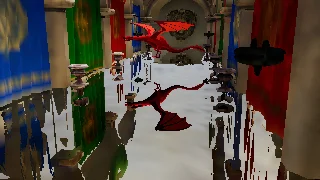

# A moving dragon in Sponza


The dragon glides along the nave with fixed wings. Sponza contributes 243,645 triangles and the rigid dragon adds 43,440, for 287,085 triangles in the scene. The preset uses one static contact hierarchy, one baked distance field, and one dragon BVH. The camera, sun and flight path are shared by the quality and performance probes. [Sponza attribution](../assets/sponza-dragon/SPONZA.md) · [Red Dragon attribution](../assets/sponza-dragon/DRAGON-LICENSE.md)

## Geometry and motion

The architecture's contact hierarchy contains 464,024 nodes across a 38 × 24 × 17 grid. Its GPU buffers occupy 60.1 MiB in total. The dragon's traversal buffers occupy another 6.5 MiB. The static FP16 field uses 304 × 192 × 136 voxels at 12.5 cm per voxel and occupies 15.1 MiB uncompressed.

At 33 camera, free-space and surface samples, the static field's distance magnitude differed from the nearest static triangle by 5.4 mm on average and 27.8 mm at worst. The baker also checks that the entire sky face and 2,405 samples in the nave are in free space. [Field generation and verification](../assets/sponza-dragon/SPONZA.md)

Sampling the flight for 10 seconds at 30 Hz covered a complete loop. At all 301 sampled poses, the dragon's lowest vertex was 0.36–0.60 m above the floor. Even the triangle bounding boxes stayed more than 0.10 m from the non-floor architecture.

## Lighting and flicker



Chromium rendered 61 poses across two seconds at 320 × 180 on the High preset with SHaRC enabled. The dragon grew from 3.0% to 5.8% of the visible surface samples as it approached the camera. At the final pose, 376 of 3,006 matched floor samples lost more than 10 percentage points of direct sun visibility when the dragon was present. At 438 samples, ambient visibility fell by more than 5 points.

| Display RGB comparison | Mean absolute difference | 95th percentile |
|---|---:|---:|
| Distant fixed surfaces between consecutive frames, dragon parked | 0.44% | 0.78% |
| Same surfaces between consecutive frames, dragon moving | 0.56% | 1.17% |
| Moving endpoint versus a separately accumulated frame at the same pose, all visible surfaces | 0.73% | 2.44% |
| Same comparison on surfaces recently uncovered by the dragon | 1.48% | 4.88% |

The background comparison spans 16 consecutive frame pairs. During motion, 0.50% of those pixel comparisons changed by more than 5% of the RGB range, up from 0.04% when parked. The same-pose reference averages frames 41–48 from the same renderer. Comparing that reference to the previous eight-frame average gives 0.17% mean drift.

When the dragon was hidden, its former silhouette differed from the settled empty view by 1.02% on the first frame. Its cast shadow took longer to fade. The affected surfaces differed by 4.41% on frame one, 3.04% on frame three and 1.17% on frame eight.

## Frame time

Headless Chromium 156 used the SwiftShader software adapter at 320 × 180 on High. AO, GI, shadows and reflections were active. SHaRC was disabled so every measured frame traced 28,800 primary AO/GI rays. Each case had three 12-frame blocks with rotated order, six warm-up frames per block and one frame in flight. Timings include the pose update, submission and wait for rendering to finish. Asset loading and the initial BVH build occurred before sampling.

| Courtyard workload | Median completed frame | 95th percentile |
|---|---:|---:|
| Empty | 480.5 ms | 1,095.2 ms |
| Dragon parked | 961.4 ms | 1,300.0 ms |
| Dragon moving | 1,581.4 ms | 1,900.3 ms |

Adding the parked dragon doubled median frame time. Moving it added a further 64.5% in this run. The moving case's block medians ranged from 1,142.5 to 1,735.8 ms. These timings include motion-dependent changes to visibility and shading. Hardware GPU frame time remains unmeasured.

The dragon BVH was built once. Each of the 36 measured moving frames refitted the instance hierarchy and uploaded 80 bytes of pose data and 32 bytes of bounds. The renderer recorded zero geometry uploads or acceleration-structure rebuilds during those frames. The 95th percentile for JavaScript preparation of the rigid scene was 0.1 ms. The median WebGPU timestamp span from the G-buffer pass through final compositing was 1,577.3 ms.

The machine-readable results include individual frame timings, image comparisons and the clearance sweep. [Measurements](sponza-dragon-results.json)

## Reproduce

Serve the checkout with `python3 -m http.server 8000`, open [the preset](http://localhost:8000/webgpu.html?scene=sponza-dragon), and use **Pause dragon** or **Show dragon** to compare poses and their lighting. For the automated probes, install Python Playwright and Chromium. The clearance check also uses Node.js and NumPy.

```sh
python3 benchmark/sponza-dragon-clearance.py
python3 test/webgpu-browser.py benchmark/sponza-dragon-quality.mjs --scene sponza-dragon --width 320 --height 180
python3 test/webgpu-browser.py benchmark/sponza-dragon-perf.mjs --scene sponza-dragon --width 320 --height 180
```

Add `--software --browser /usr/bin/chromium` to the browser probes to reproduce the software setup. For hardware timings, run the performance probe on an idle WebGPU adapter at your target resolution.
