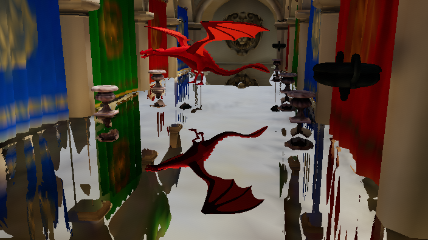
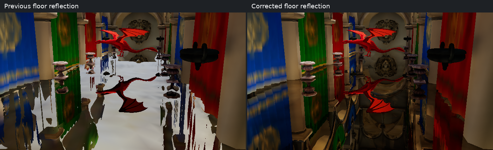

# A moving dragon reflected in the Sponza courtyard



The WebGPU preset frames the gliding dragon and its reflection from a camera 1.5 m above the nave floor, looking down toward the courtyard center. Sponza contributes 243,645 static triangles and the rigid dragon adds 43,440, for 287,085 in the scene. The dragon keeps its modeled wing pose. By default, rays intersect its local-space triangle BVH. The **Dragon tracing** control also offers a 25 mm voxel SDF. The architecture uses a static contact hierarchy and baked distance field. [Sponza attribution](../assets/sponza-dragon/SPONZA.md) · [Red Dragon attribution](../assets/sponza-dragon/DRAGON-LICENSE.md)

## Geometry and motion

The architecture's contact hierarchy contains 464,024 nodes across a 38 × 24 × 17 grid. Its GPU buffers occupy 60.1 MiB in total. The dragon's traversal buffers occupy another 6.5 MiB. The static FP16 field uses 304 × 192 × 136 voxels at 12.5 cm per voxel and occupies 15.1 MiB uncompressed.

At 33 reference points in free space and on surfaces, the static field's distance magnitude differed from the nearest static triangle by 5.4 mm on average and 27.8 mm at worst. The baker also checks that the entire sky face and 2,405 samples in the nave are in free space. [Field generation and verification](../assets/sponza-dragon/SPONZA.md)

Sampling the flight for 10 seconds at 30 Hz covered a complete loop. At all 301 sampled poses, the dragon's lowest vertex was 0.36–0.60 m above the floor. Even the triangle bounding boxes stayed more than 0.10 m from the non-floor architecture.

## Dragon tracing comparison

At two flight poses, Chromium with SwiftShader traced the same 1,086 rays per mode. Independent CPU triangle intersections supplied the reference. The BVH matched every hit and miss. The voxel SDF recovered all 476 reference hits and produced two extra hits. On the wings, its 95th-percentile distance error was 2.3 mm for face-on rays and 89 mm for grazing rays. All 32 rays aimed through known gaps in the bounding box passed through. [GPU probe](../test/sponza-dragon-queries.mjs) · [Same-pose images](sponza-dragon-trace-modes.png)

At 512 × 288 on High, the primary depth and normals matched across modes at both poses. The reflected red dragon pixels overlapped by 90.7% at 0 s and 92.2% at 2 s, measured as the intersection divided by the union after subtracting the empty-floor image.

## Floor reflections



The ground-floor mirror rasterizes Sponza’s triangles from the reflected camera and traces the selected dragon representation up to the nearest static hit. This restores the columns, banners and arches across the floor. The previous mirror traced a 12.5 cm static distance field, capped its rays at 10.5 m and used the coarse radiance volume when it could not recover the surface color from the main view. These approximations produced broken silhouettes and misplaced colors. The current mirror shows one bounce. Lighting estimates on offscreen surfaces still use the distance field and radiance volume. [Floor material and reflection path](../assets/sponza-dragon/SPONZA.md)

For each interior mirror pixel at 704 × 396, the CPU reference intersects the camera ray with the courtyard floor at *z* = 0 and reflects the direction about the floor normal. It starts 0.1 mm along that reflected ray to clear the mirror itself, then finds the nearest double-sided static triangle out to 100 m. We compared the old shader’s instrumented hit distance at commit `9cce731` with the new raster pass’s distance, counting misses as failures. The camera and geometry were identical. [Capture probe](sponza-reflection-capture.mjs) · [Triangle reference](sponza-reflection-reference.py)

| Reflected surface | Reference hits | Previous depth within 5 cm | Planar depth within 5 cm |
|---|---:|---:|---:|
| All architecture | 134,875 | 22.6% | 99.65% |
| Arches | 20,268 | 35.1% | 98.63% |
| Columns | 24,598 | 11.5% | 99.61% |
| Banners | 51,552 | 26.8% | 99.88% |

The old trace reported 65,541 of the 134,875 static hits. The planar pass reported all of them. Its median absolute distance error was 1.7 mm and its 95th percentile was 6.8 mm.

Among 40,870 pixels that should show saturated banners, the reflections-only view reproduced the expected dominant color channel at 99.8%, up from 52.5%. At 74,969 reflected points also visible in the main camera, the mean display-RGB difference between the reflection and the image of the same surface changed from 33.0% to 4.1%. View-dependent highlights and the lighting approximation can still change the color.

The CPU reference intersects the posed dragon triangles along the same physical rays and checks visibility against the static hit. The overlap of that silhouette with the red reflection, measured by intersection over union, changed from 80.3% to 91.0% at 0 seconds and from 80.5% to 92.1% at 2 seconds. The earlier projected-mask test added the shader’s 3.2 cm origin offset to its reference and overstated the alignment. [Full measurements](sponza-dragon-results.json)

## Lighting and flicker


Chromium rendered 61 poses across two seconds at 320 × 180 on High with SHaRC enabled. The dragon itself covered 1.7% of the visible surface samples initially and 2.6% at the endpoint. At that endpoint, 149 of 7,159 matched floor samples lost more than 10 percentage points of direct sun visibility when the dragon was present. Ambient visibility fell by more than 5 points at 102 floor samples.

| Display RGB comparison | Mean absolute difference | 95th percentile |
|---|---:|---:|
| Distant fixed surfaces between consecutive frames, dragon parked | 0.40% | 0.78% |
| Same surfaces between consecutive frames, dragon moving | 0.58% | 0.93% |
| Moving endpoint versus a separately accumulated frame at the same pose, all visible surfaces | 0.43% | 1.12% |
| Same comparison on surfaces recently uncovered by the dragon | 0.86% | 2.98% |

The background comparison spans 16 consecutive frame pairs. During motion, 1.20% of those pixel comparisons changed by more than 5% of the RGB range, compared with 0.0002% when parked. Movement in the reflection can also change these static-surface pixels. The same-pose reference averages frames 41–48 from the same renderer. Comparing that reference with the previous eight-frame average gives 0.08% mean drift.

After hiding the dragon, the pixels in its former silhouette differed from the settled empty view by 0.76% on the first frame. On surfaces that had received its shadow, the difference was 0.48% on frame one, 0.44% on frame three and 0.44% on frame eight.

## Frame time

Headless Chromium 156 used the SwiftShader software adapter at 320 × 180 on High. AO, GI, shadows and reflections were active, including the courtyard’s reflected-camera render. SHaRC was disabled so every measured frame traced 28,800 primary AO/GI rays. Each case had three 12-frame blocks with rotated order, six warm-up frames per block and one frame in flight. Timings include the pose update, submission and wait for rendering to finish. Asset loading and the initial BVH build occurred before sampling.

| Courtyard workload | Median completed frame | 95th percentile |
|---|---:|---:|
| Empty | 881.4 ms | 1,611.8 ms |
| Dragon parked | 1,611.0 ms | 3,084.9 ms |
| Dragon moving | 1,598.6 ms | 1,818.0 ms |

The parked dragon took 1.83× the empty-courtyard median frame time. The moving dragon took 0.99× the parked median, with block medians ranging from 1,535.9 ms to 1,655.5 ms. These software timings include pose-dependent changes to visibility and shading. An earlier run that traced the static architecture with its SDF and used the triangle BVH for the dragon recorded 518.1 ms empty, 1,069.0 ms parked and 1,043.2 ms moving. The moving case was 53% slower in the planar run. These separate runs also include run-to-run variation. Hardware GPU timings remain unmeasured. [Previous measurements](https://github.com/zhaoyangyang316/Fast-SDF-AO/blob/9cce731284a70d269839343824254fb40b1620c3/benchmark/sponza-dragon-results.json)

The dragon BVH was built once. Each of the 36 measured moving frames refitted the instance hierarchy and uploaded 80 bytes of pose data and 32 bytes of bounds. The renderer recorded zero geometry uploads or acceleration-structure builds during those frames. The 95th percentile for JavaScript preparation of the rigid scene was 0.2 ms. The median WebGPU timestamp span from the G-buffer pass through final compositing was 1,594.6 ms.

The machine-readable results include individual frame timings, image comparisons, mirror checks and the clearance sweep. [Measurements](sponza-dragon-results.json)

## Reproduce

Serve the checkout with `python3 -m http.server 8000`, open [the preset](http://localhost:8000/webgpu.html?scene=sponza-dragon), and use **Pause dragon** to hold a pose. Toggle **Reflections** to inspect the floor with the dragon still in view, or toggle **Show dragon** for the empty courtyard. For the automated probes, install Python Playwright and Chromium. The clearance check uses Node.js and NumPy. The independent mirror reference also requires Pillow, SciPy and VTK.

```sh
python3 benchmark/sponza-dragon-clearance.py
python3 test/webgpu-browser.py test/sponza-dragon-queries.mjs --scene sponza-dragon
python3 test/webgpu-browser.py test/sponza-dragon-trace-modes.mjs --scene sponza-dragon --width 512 --height 288 --probe-args '{"liveLoop":true}'
python3 test/webgpu-browser.py benchmark/sponza-reflection-capture.mjs --scene sponza-dragon --width 704 --height 396 > capture.json
python3 benchmark/sponza-reflection-reference.py capture.json --out mirror-check
python3 test/webgpu-browser.py benchmark/sponza-dragon-quality.mjs --scene sponza-dragon --width 320 --height 180
python3 test/webgpu-browser.py benchmark/sponza-dragon-perf.mjs --scene sponza-dragon --width 320 --height 180
```

The reference command writes `mirror-check/reference-checks.json` and comparison images from the captured geometry and framebuffer readbacks. Add `--software --browser /usr/bin/chromium` to the browser probes to reproduce the software setup. For hardware timings, run the performance probe on an idle WebGPU adapter at your target resolution.
